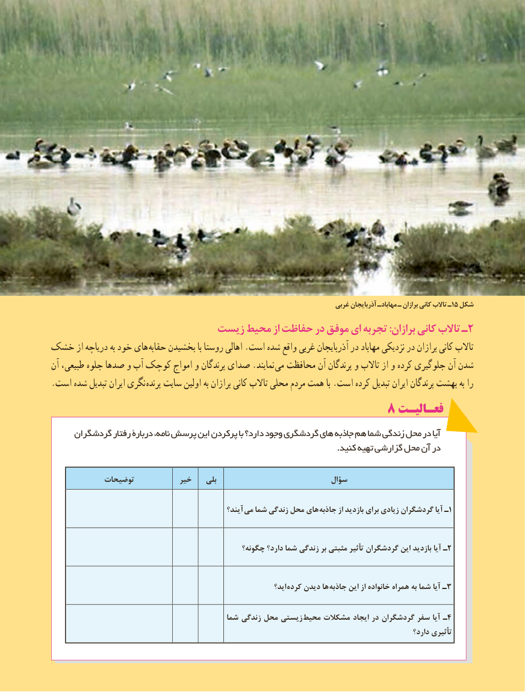

# PDF page 119

غربی آذربایجان مهابادـ ـ برازان کانی تاالب ـ15 شکل
   زیست٢محیط از حفاظت در موفق ای تجربه :برازان کانی تاالب ـ
خشک از دریاچه به خود های  حقابه بخشیدن با روستا اهالی .است شده واقع غربی آذربایجان در مهاباد نزدیکی در برازان کانی تاالب
آن طبیعی، جلوه صدها و آب کوچک امواج و پرندگان صدای .نمایند  می محافظت آن پرندگان و تاالب از و کرده جلوگیری آن شدن
. است شده تبدیل ایران نگری پرنده سایت اولین به برازان کانی تاالب محلی مردم همت با .است کرده تبدیل ایران پرندگان بهشت به را
                                           8 فعـالیـت
     گردشگران رفتار دربارۀ نامه، پرسش این پرکردن با دارد؟ وجود گردشگری های جاذبه هم شما زندگی محل در آیا
                                                                                                         .کنید تهیه گزارشی محل آن در

            توضیحات           خیر    بلی                            سؤال

                                                    آیند؟  می شما زندگی محل های جاذبه از بازدید برای زیادی گردشگران آیا ـ1

                                                  چگونه؟ دارد؟ شما زندگی بر مثبتی تأثیر گردشگران این بازدید آیا ـ2

                                                                       اید؟ کرده دیدن ها  جاذبه این از خانواده همراه به شما آیا ـ3

                                            شما زندگی محل زیستی  محیط مشکالت ایجاد در گردشگران سفر آیا ـ4
                                                                                                              دارد؟ تأثیری
                                                       111111

