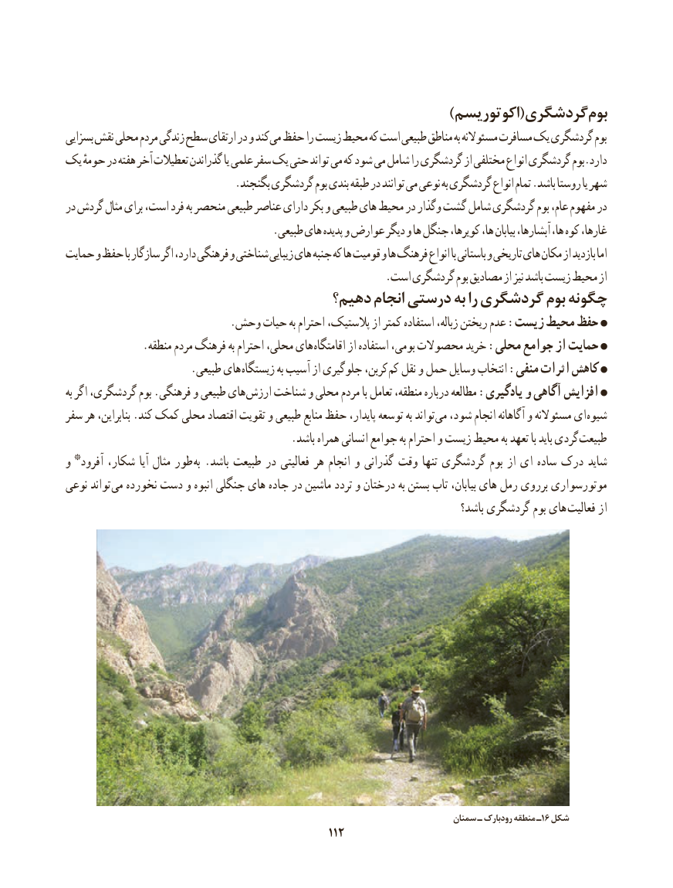

# PDF page 120

)اکوتوریسم(گردشگری بوم
بسزایی نقش محلی مردم زندگی سطح ارتقای در و کند می حفظ را زیست محیط که است طبیعی مناطق به مسئوالنه مسافرت یک گردشگری بوم
یک حومهٔ در هفته آخر تعطیالت گذراندن یا علمی سفر یک حتی تواند می که شود می شامل را گردشگری از مختلفی انواع گردشگری بوم.دارد
                               .بگنجند گردشگری بوم بندی طبقه در توانند می نوعی به گردشگری انواع تمام .باشد روستا یا شهر
در گردش مثال برای است، فرد به منحصر طبیعی عناصر دارای بکر و طبیعی های محیط در گذار و گشت شامل گردشگری بوم عام، مفهوم در
                                      .طبیعی های پدیده و عوارض دیگر و ها جنگل کویرها، ها، بیابان آبشارها، ها، کوه غارها،
حمایت و حفظ با سازگار اگر دارد، فرهنگی و شناختی زیبایی های جنبه که ها قومیت و ها فرهنگ انواع با باستانی و تاریخی های مکان از بازدید اما
                                                           .است گردشگری بوم مصادیق از نیز باشد زیست محیط از
                                  دهیم؟ انجام درستی به را گردشگری بوم چگونه
                               .وحش حیات به احترام پالستیک، از کمتر استفاده زباله، ریختن عدم :زیست محیط حفظ
              .منطقه مردم فرهنگ به احترام محلی، های اقامتگاه از استفاده بومی، محصوالت خرید :محلی جوامع از حمایت
                       .طبیعی های زیستگاه به آسیب از جلوگیری کربن، کم نقل و حمل وسایل انتخاب :منفی اثرات کاهش
به اگر گردشگری، بوم .فرهنگی و طبیعی های ارزش شناخت و محلی مردم با تعامل منطقه، درباره مطالعه :یادگیری و آگاهی افزایش
سفر هر بنابراین، .کند کمک محلی اقتصاد تقویت و طبیعی منابع حفظ پایدار، توسعه به تواند می شود، انجام آگاهانه و مسئوالنه ای شیوه
                                          .باشد همراه انسانی جوامع به احترام و زیست محیط به تعهد با باید گردی طبیعت
و * آفرود شکار، آیا مثال طور به .باشد طبیعت در فعالیتی هر انجام و گذرانی وقت تنها گردشگری بوم از ای ساده درک شاید
نوعی تواند می نخورده دست و انبوه جنگلی های جاده در ماشین تردد و درختان به بستن تاب بیابان، های رمل برروی موتورسواری
                                                                                      باشد؟ گردشگری بوم های  فعالیت از

                              سمنان١شکلـ رودبارک منطقه ـ ٦
                                                112112

