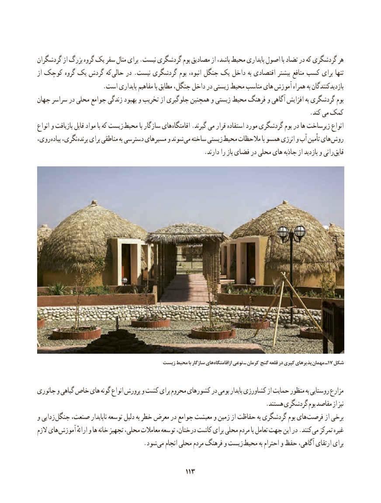

# PDF page 121

گردشگران از بزرگ گروه یک سفر مثال برای .نیست گردشگری بوم مصادیق از باشد، محیط پایداری اصول با تضاد در که گردشگری هر
از کوچک گروه یک گردش که حالی در .نیست گردشگری بوم انبوه، جنگل یک داخل به اقتصادی بیشتر منافع کسب برای تنها
                      .است پایداری مفاهیم با مطابق جنگل، داخل در زیستی محیط مناسب های آموزش همراه به بازدیدکنندگان
جهان سراسر در محلی جوامع زندگی بهبود و تخریب از جلوگیری همچنین و زیستی محیط فرهنگ و آگاهی افزایش به گردشگری بوم
                                                                                         .کند می کمک
انواع و بازیافت قابل مواد با که زیست محیط با سازگار های اقامتگاه .گیرند می قرار استفاده مورد گردشگری بوم در ها زیرساخت انواع
روی، پیاده نگری، پرنده برای مناطقی به دسترسی مسیرهای و شوند می ساخته زیستی محیط مالحظات با همسو انرژی و آب تأمین های روش
   . دارند را باز فضای در محلی های جاذبه از بازدید و رانی قایق

                                        زیست محیط با سازگار های ازاقامتگاه نوعی ـ کرمان گنج قلعه در کپری پذیرهای مهمان١٧ـ  شکل

جانوری و گیاهی خاص های گونه انواع پرورش و کشت برای محروم کشورهای در بومی پایدار کشاورزی از حمایت منظور به روستایی مزارع
                                                                           .هستند گردشگری بوم مقاصد از نیز
و زدایی جنگل صنعت، ناپایدار توسعه دلیل به خطر معرض در جوامع معیشت و زمین از حفاظت به گردشگری بوم های فرصت از برخی
الزم های آموزش ارائهٔ و ها خانه تجهیز محلی، معامالت توسعه درختان، کاشت برای محلی مردم با تعامل جهت این در .کنند می تمرکز غیره
              . شود می انجام محلی مردم فرهنگ و زیست محیط به احترام و حفظ آگاهی، ارتقای برای

                                             113113

