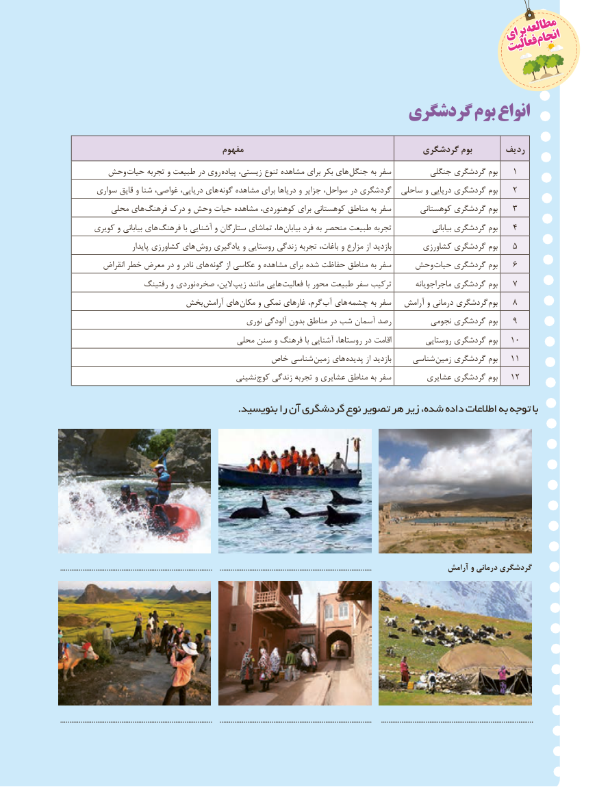

# PDF page 122

مطالعهمطالعه                                                                   برایبرای                                                                                  انجامانجام                                                                            فعالیتفعالیت

                                      گردشگری بوم انواع

                                      مفهوم                                   گردشگری بوم       ردیف
        وحش حیات تجربه و طبیعت در روی پیاده زیستی، تنوع مشاهده برای بکر های جنگل به سفر         جنگلی گردشگری بوم   ١
         سواری قایق و شنا غواصی، دریایی، های گونه مشاهده برای دریاها و جزایر سواحل، در گردشگری  ساحلی و دریایی گردشگری بوم   ٢
            محلی های  فرهنگ درک و وحش حیات مشاهده کوهنوردی، برای کوهستانی مناطق به سفر       کوهستانی گردشگری بوم   ٣
        کویری و بیابانی های فرهنگ با آشنایی و ستارگان تماشای ها، بیابان فرد به منحصر طبیعت تجربه               بیابانی گردشگری بوم   ٤
                          پایدار کشاورزی های روش یادگیری و روستایی زندگی تجربه باغات، و مزارع از بازدید        کشاورزی گردشگری بوم   ٥
            انقراض خطر معرض در و نادر های  گونه از عکاسی و مشاهده برای شده حفاظت مناطق به سفر    وحش حیات گردشگری بوم   ٦
                     رفتینگ و نوردی صخره الین، زیپ مانند هایی فعالیت با محور طبیعت سفر ترکیب       ماجراجویانه گردشگری بوم   ٧
                      بخش آرامش های  مکان و نمکی غارهای گرم، آب های چشمه به سفر   آرامش و درمانی گردشگری بوم   ٨
                                                نوری آلودگی بدون مناطق در شب آسمان رصد         نجومی گردشگری بوم   ٩
                                        محلی سنن و فرهنگ با آشنایی روستاها، در اقامت         روستایی گردشگری بوم   ٠١
                                     خاص شناسی  زمین های پدیده از بازدید     شناسی  زمین گردشگری بوم   ١١
                                           نشینی کوچ زندگی تجربه و عشایری مناطق به سفر         عشایری گردشگری بوم   ٢١

                                                      .بنویسید را آن گردشگری نوع تصویر هر زیر شده، داده اطالعات به توجه با

..................................................................................    ..................................................................................                  آرامش و درمانی گردشگری

..................................................................................    ..................................................................................     ..................................................................................
                                               114114

