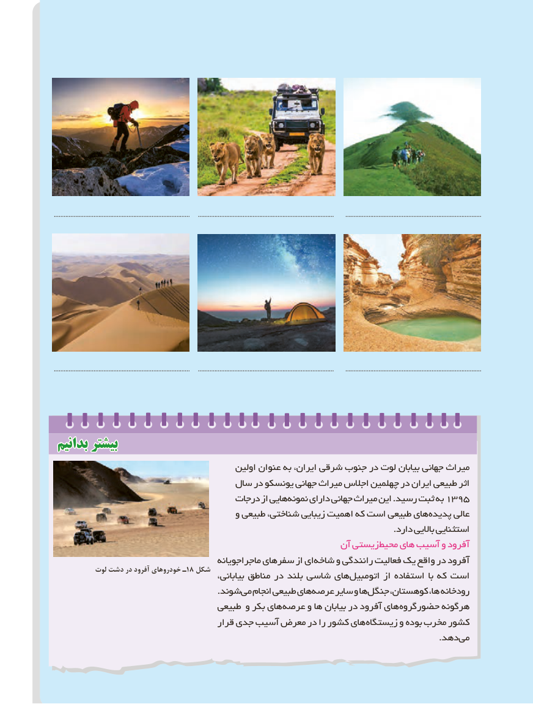

# PDF page 123

..................................................................................     ..................................................................................       ..................................................................................

..................................................................................     ..................................................................................       ..................................................................................

 بدانیمبدانیم بیشتربیشتر
                                            اولین عنوان به ایران، شرقی جنوب در لوت بیابان جهانی میراث
                                سال در یونسکو جهانی میراث اجالس چهلمین در ایران طبیعی اثر
                                     درجات از هایی نمونه دارای جهانی میراث این .رسید ثبت به 1395
                                       و طبیعی شناختی، زیبایی اهمیت که است طبیعی های پدیده عالی
                                                                                                                  .دارد باالیی استثنایی
                                                        آن زیستی محیط های آسیب و آفرود
                                         ماجراجویانه سفرهای از ایشاخه‌    و رانندگی فعالیت یک واقع در آفرود
           لوت دشت در آفرود خودروهای ـ18 شکل                                                بیابانی، مناطق در بلند شاسی هایاتومبیل‌        از استفاده با که است
                                                       .شوندمی‌  انجام طبیعی های عرصه سایر و ها جنگل کوهستان، ها، رودخانه‌
                                  طبیعی و بکر های عرصه و ها  بیابان در آفرود های حضورگروه هرگونه
                                       قرار جدی آسیب معرض در را کشور های زیستگاه و بوده مخرب کشور
                                   . دهدمی
                                              115115

