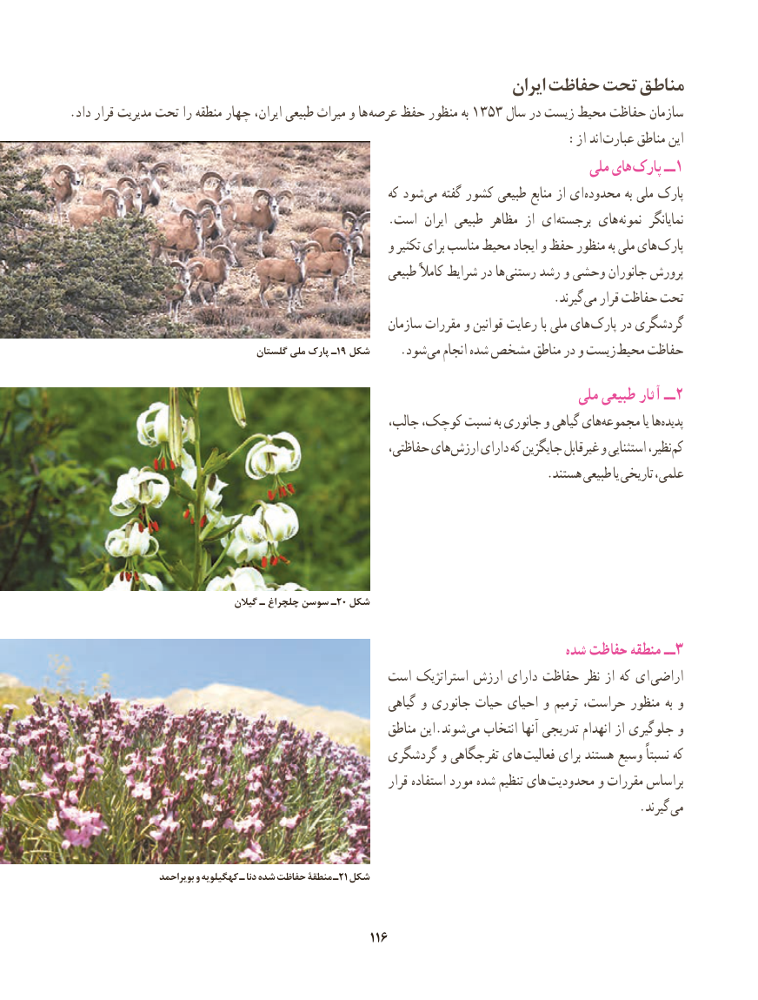

# PDF page 124

ایران حفاظت تحت مناطق
.داد قرار مدیریت تحت را منطقه چهار ایران، طبیعی میراث و ها عرصه حفظ منظور به 1353 سال در زیست محیط حفاظت سازمان
                           : از اند عبارت مناطق این
                                                                               ملی های پارک ــ1
                                                           که شود می گفته کشور طبیعی منابع از ای محدوده به ملی پارک
    . است  ایران طبیعی مظاهر  از ای برجسته های نمونه  نمایانگر
                                                     و تکثیر برای مناسب محیط ایجاد و حفظ منظور به ملی های پارک
                                                        طبیعی کامالً شرایط در ها رستنی رشد و وحشی جانوران پرورش
                             . گیرند می قرار حفاظت تحت
                                                         سازمان مقررات و قوانین رعایت با ملی های پارک در گردشگری
                                    گلستان ملی پارک ـ19 شکل                      . شود می انجام شده مشخص مناطق در و زیست محیط حفاظت
                                                                              ملی طبیعی آثار ــ 2
      ،هایجالب کوچک، نسبت به جانوری و گیاهی        مجموعه یا ها پدیده
                                                      حفاظتی، های ارزش دارای که جایگزین غیرقابل و استثنایی نظیر، کم
                                                                               .هستند طبیعی یا تاریخی علمی،

         گیالن٢ـ چلچراغ سوسن ـ 0 شکل

                 شده۳حفاظت منطقه ــ
                                         است استراتژیک ارزش دارای حفاظت نظر از که ای  اراضی
                                                         گیاهی و جانوری حیات احیای و ترمیم حراست، منظور به و
                                                        مناطق این.شوند می انتخاب آنها تدریجی انهدام از جلوگیری و
                                             گردشگری و تفرجگاهی های  فعالیت برای هستند وسیع نسبتاً که
                                                                قرار استفاده مورد شده تنظیم های محدودیت و مقررات براساس
                                                                                              .گیرند می

    بویراحمد٢و کهگیلویه ـ دنا شده حفاظت منطقۀ ـ 1 شکل

                                                                                                  116116

