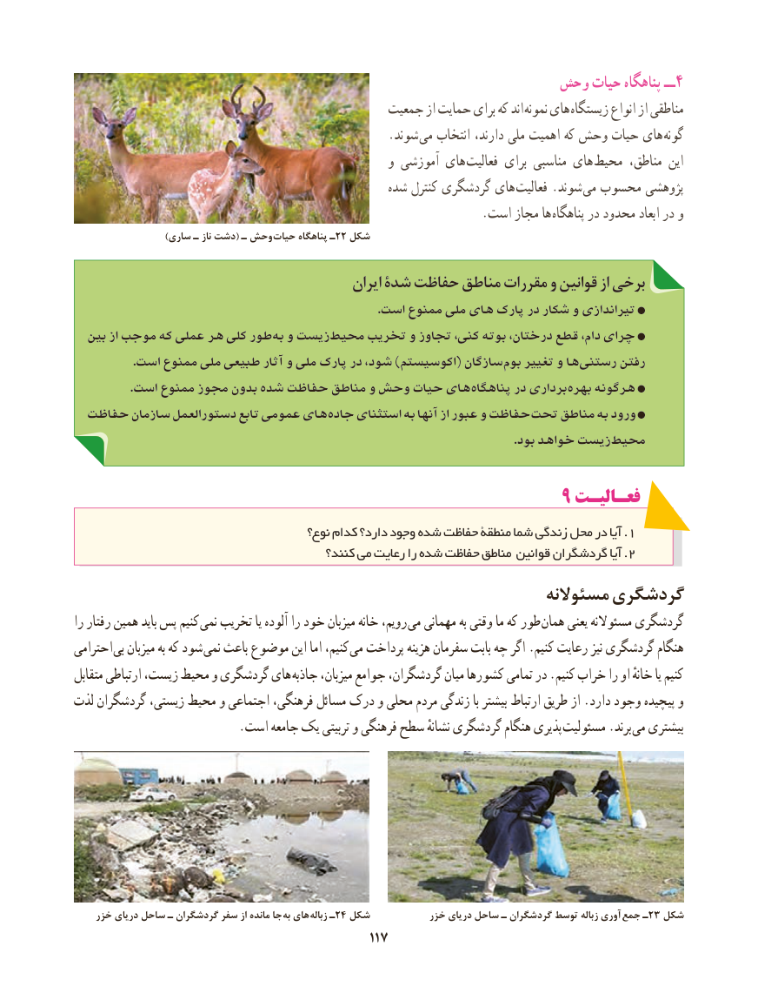

# PDF page 125

وحش۴حیات پناهگاه ــ
                                            جمعیت از حمایت برای که اند  نمونه های زیستگاه انواع از مناطقی
                                                    .شوند  می انتخاب دارند، ملی اهمیت که وحش حیات های گونه
                                                    و آموزشی های فعالیت برای مناسبی های  محیط مناطق، این
                                                 شده کنترل گردشگری های  فعالیت .شوند می محسوب پژوهشی
           . است مجاز ها پناهگاه در محدود ابعاد در و
                        )ساری ـ ناز دشت( ـ وحش  حیات٢پناهگاه ـ 2 شکل

                                               ایران شدۀ حفاظت مناطق مقررات و قوانین از برخی
                                                                                            .است ممنوع ملی های پارک در شکار و تیراندازی
  بین از موجب که عملی هر کلی طور به و زیست محیط تخریب و تجاوز کنی، بوته درختان، قطع دام، چرای
                  .است ممنوع ملی طبیعی آثار و ملی پارک در شود، )اکوسیستم( سازگان بوم تغییر و ها رستنی رفتن
. است ممنوع مجوز بدون شده حفاظت مناطق و وحش حیات های پناهگاه در برداری بهره هرگونه
  حفاظت سازمان دستورالعمل تابع عمومی های جاده استثنای به آنها از عبور و حفاظت تحت مناطق به ورود
                                                                                                                                     .بود خواهد زیست محیط

                                                       9 فعـالیـت
                                         نوع؟ کدام دارد؟ وجود شده حفاظت منطقۀ شما زندگی محل در آیا . 1
                                           کنند؟ می رعایت را شده حفاظت مناطق قوانین گردشگران آیا . 2
                                                            مسئوالنه گردشگری
را رفتار همین باید پس کنیم نمی تخریب یا آلوده را خود میزبان خانه رویم، می مهمانی به وقتی ما که طور همان یعنی مسئوالنه گردشگری
احترامی بی میزبان به که شود نمی باعث موضوع این اما کنیم، می پرداخت هزینه سفرمان بابت چه اگر .کنیم رعایت نیز گردشگری هنگام
متقابل ارتباطی زیست، محیط و گردشگری های جاذبه میزبان، جوامع گردشگران، میان کشورها تمامی در .کنیم خراب را او خانهٔ یا کنیم
لذت گردشگران زیستی، محیط و اجتماعی فرهنگی، مسائل درک و محلی مردم زندگی با بیشتر ارتباط طریق از .دارد وجود پیچیده و
 . است جامعه یک تربیتی و فرهنگی سطح نشانهٔ گردشگری هنگام پذیری مسئولیت .برند می بیشتری

    خزر دریای ساحل ـ گردشگران سفر از مانده جا به های زباله٢ـ 4 شکل           خزر دریای ساحل ـ گردشگران توسط زباله آوری جمع ـ23 شکل
                                              117117

