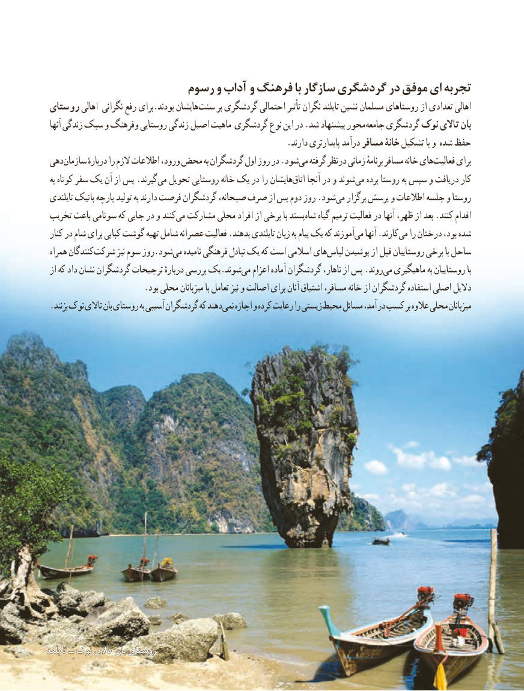

# PDF page 126

رسوم و آداب و فرهنگ با سازگار گردشگری در موفق ای تجربه
 روستای اهالی نگرانی رفع برای.بودند هایشانسنت‌      بر گردشگری احتمالی تأثیر نگران تایلند نشین مسلمان روستاهای از تعدادی اهالی
  آنها زندگی سبک و وفرهنگ روستایی زندگی اصیل ماهیت گردشگری نوع این در .شد پیشنهاد محور جامعه گردشگری نوک تاالی بان
                                                          .دارند پایدارتری درآمد مسافر خانۀ تشکیل با و شده حفظ
 دهیسازمان‌        دربارهٔ را الزم اطالعات ورود، محض به گردشگران اول روز در .شودمی‌  گرفته نظر در زمانی برنامهٴ مسافر خانه هایفعالیت‌     برای
  به کوتاه سفر یک آن از پس .گیرند می تحویل روستایی خانه یک در را هایشاناتاق‌    آنجا در و شوندمی‌   برده روستا به سپس و دریافت کار
 تایلندی باتیک پارچه تولید به دارند فرصت گردشگران صبحانه، صرف از پس دوم روز .شودمی‌   برگزار پرسش و اطالعات جلسه و روستا
 تخریب باعث سونامی که جایی در و کنندمی‌  مشارکت محلی افراد از برخی با پسندشاه‌    گیاه ترمیم فعالیت در آنها ظهر، از بعد .کنند اقدام
 کنار در شام برای کبابی گوشت تهیه شامل عصرانه فعالیت .بدهند تایلندی زبان به پیام یک که آموزندمی‌   آنها .کارندمی‌   را درختان بود، شده
 همراه کنندگانشرکت‌       نیز سوم روز.شودمی‌   نامیده فرهنگی تبادل یک که است اسالمی هایلباس‌    پوشیدن از قبل روستاییان برخی با ساحل
 از که داد نشان گردشگران ترجیحات دربارهٔ بررسی یک.شوندمی‌   اعزام آماده گردشگران ناهار، از پس .روندمی‌  ماهیگیری به روستاییان با
                        .بود محلی میزبانان با تعامل نیز و اصالت برای آنان اشتیاق مسافر، خانه از گردشگران استفاده اصلی دالیل
 .بزنند نوک تاالی بان روستای به آسیبی گردشگران كه دهند نمی اجازه و كرده رعایت را زیستی محیط مسائل آمد، در كسب بر عالوه محلی میزبانان

تایلندتایلند ــ نوکنوک تاالیتاالی بانبان روستایروستای                         118118

