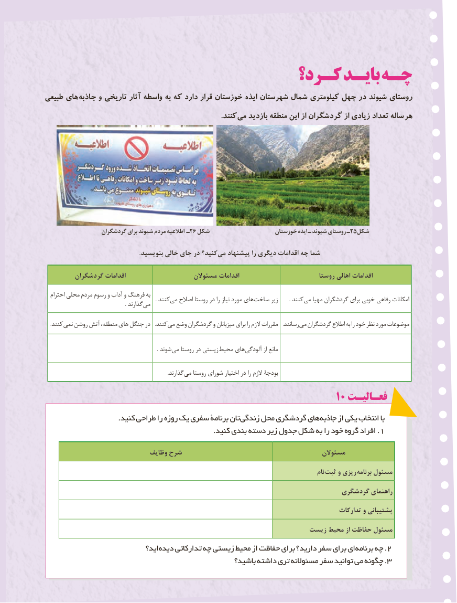

# PDF page 127

كـرد؟ بایـد چـه
طبیعی های جاذبه و تاریخی آثار واسطه به که دارد قرار خوزستان ایذه شهرستان شمال کیلومتری چهل در شیوند روستای
                   . کنند می بازدید منطقه این از گردشگران از زیادی تعداد ساله هر

                  گردشگران برای شیوند مردم اطالعیه ـ26 شکل                     خوزستان ایذه ـ شیوند روستای ـ25شکل

                                                            .بنویسید خالی جای در کنید؟ می پیشنهاد را دیگری اقدامات چه شما

        گردشگران اقدامات                    مسئوالن اقدامات                         روستا اهالی اقدامات

  احترام محلی مردم رسوم و آداب و فرهنگ به              . کنند می اصالح روستا در را نیاز مورد های ساخت زیر         . کنند می مهیا گردشگران برای خوبی رفاهی امکانات        . گذارند می

 . کنند نمی روشن آتش منطقه، های جنگل در   .کنند می وضع گردشگران و میزبانان برای را الزم مقررات . رسانند می گردشگران اطالع به را خود نظر مورد موضوعات

              . شوند می روستا در زیستی محیط های آلودگی از مانع

              . گذارند می روستا شورای اختیار در را الزم بودجۀ
                                                             10 فعـالیـت
 . کنید طراحی را روزه یک سفری برنامۀ تانزندگی محل گردشگری های جاذبه از یکی انتخاب با
          . کنید بندی دسته زیر جدول شکل به را خود  .گروه افراد 1

                              وظایف شرح                                         مسئوالن
                                                                                                               نام ثبت و ریزی  برنامه مسئول
                                                                           گردشگری راهنمای
                                                                                             تدارکات و پشتیبانی
                                                              زیست محیط از حفاظت مسئول
                               اید؟ دیده تدارکاتی چه زیستی محیط از حفاظت برای دارید؟ سفر برای ای .برنامه چه 2
                                             119119   باشید؟ داشته تری مسئوالنه سفر توانید می چگونه .3

