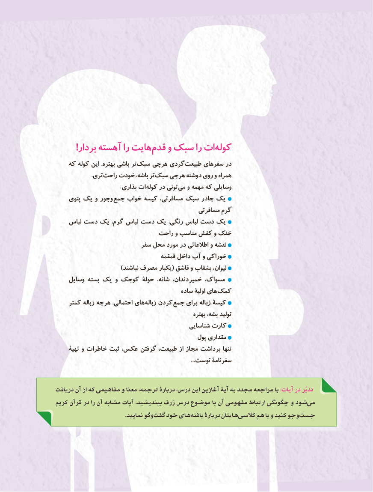

# PDF page 128

!بردار آهسته را هایت قدم و سبک را ات کوله
    که کوله این .بهتره باشی تر سبک چی هر گردی طبیعت سفرهای در
                         .تری راحت خودت باشه، تر سبک چی هر دوشته روی و همراه
     : بذاری ات کوله در تونی می و مهمه که وسایلی
    پتوی یک و وجور جمع خواب کیسه مسافرتی، سبک چادر یک
                                              مسافرتی گرم
    لباس دست یک گرم، لباس دست یک رنگی، لباس دست یک
                            راحت و مناسب کفش و خنک
                         سفر محل مورد در اطالعاتی و نقشه
                                    قمقمه داخل آب و خوراکی
                             )نباشند مصرف یکبار( قاشق و بشقاب لیوان،
    وسایل بسته یک و کوچک حولۀ شانه، دندان، خمیر مسواک،
                                         ساده اولیۀ های کمک
    کمتر زباله چه هر .احتمالی های زباله کردن جمع برای زباله کیسۀ
                                                       بهتره بشه، تولید
                                            شناسایی کارت
                                                پول مقداری
     تهیۀ و خاطرات ثبت عکس، گرفتن طبیعت، از مجاز برداشت تنها
                                                                                                 ...توست سفرنامۀ

دريافت آن از كه مفاهيمي و معنا ترجمه، دربارۀ درس، اين آغازين آيۀ به مجدد مراجعه با :آیات در تدبّر
كريم قرآن در را آن مشابه آيات .بينديشيد ژرف درس موضوع با آن مفهومی ارتباط چگونگی و شود می
                                           .نماييد وگو گفت خود های يافته دربارۀ هايتان كالسی  هم با و كنيد وجو جست

                                             120120

