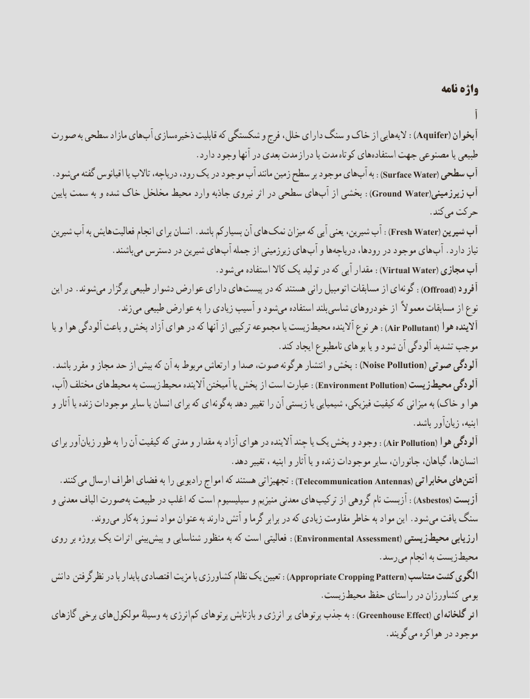

# PDF page 129

نامه واژه
                                                                                                        آ
صورت به سطحی مازاد های ‌آب سازی‌ذخیره قابلیت که شکستگی و فرج خلل، دارای سنگ و خاک از هاییالیه‌):Aquifer( آبخوان
   . دارد وجود آنها در بعدی مدت دراز یا مدت کوتاه های‌استفاده جهت مصنوعی یا طبیعی
.‌شودمی گفته اقیانوس یا تاالب دریاچه، رود، یک در موجود آب مانند زمین سطح بر موجود هایآب‌):به  Sur face Water( سطحی آب
پایین سمت به و شده خاک مخلخل محیط وارد جاذبه نیروی اثر در سطحی هایآب‌):از بخشی  Ground  Water(زیرزمینی آب
                                          .‌کندمی حرکت
شیرین آب به هایش  فعالیت انجام برای انسان .باشد بسیارکم آن های ):نمک میزان که آبی یعنی شیرین، آب  Fresh Water( شیرین آب
     . باشند می دسترس در شیرین های آب جمله از زیرزمینی های آب و ها‌دریاچه رودها، در موجود های آب .دارد نیاز
    . ):شود می استفاده کاال یک تولید در که آبی مقدار   Vir tual Water( مجازی آب
این در .شوند‌می برگزار طبیعی دشوار عوارض دارای های  پیست در که هستند رانی اتومبیل مسابقات از ای ‌):گونه  Offroad( آفرود
        . زند می طبیعی عوارض به را زیادی آسیب و شودمی‌   استفاده بلند  شاسی خودروهای از معموالً مسابقات از نوع
یا و هوا آلودگی باعث و پخش آزاد هوای در که آنها از ترکیبی مجموعه یا زیست ):محیط آالینده نوع هر  Air Pollutant( هوا آالینده
                                                     .کند ایجاد نامطبوع های بو یا و شود آن آلودگی تشدید موجب
.باشد مقرر و مجاز حد از بیش که آن به مربوط ارتعاش و صدا صوت، هرگونه انتشار و پخش ):Noise Pollution( صوتی آلودگی
آب،( مختلف های محیط به زیست ):محیط آالینده آمیختن یا پخش از است عبارت  Environment Pollution( زیست محیط آلودگی
و آثار یا زنده موجودات سایر یا انسان برای که ای گونه به دهد تغییر را آن زیستی یا شیمیایی فیزیکی، کیفیت که میزانی به )خاک و هوا
                                                                                     .باشد آور زیان ابنیه،
برای آور ):زیان طور به را آن کیفیت که مدتی و مقدار به آزاد هوای در آالینده چند یا یک پخش و وجود  Air Pollution( هوا آلودگی
                                          .دهد تغییر ، ابنیه و آثار یا و زنده موجودات سایر جانوران، گیاهان، ها، انسان
. ):کنند می ارسال اطراف فضای به را رادیویی امواج که هستند تجهیزاتی  Telecommunication Antennas( مخابراتی های  آنتن
و معدنی الیاف صورت به طبیعت در اغلب که است سیلیسیوم و منیزیم معدنی های ):ترکیب از گروهی نام آزبست  Asbestos( آزبست
    . روند می کار به نسوز مواد عنوان به دارند آتش و گرما برابر در که زیادی مقاومت خاطر به مواد این .شود می یافت سنگ
روی بر پروژه یک اثرات بینی  ):پیش و شناسایی منظور به که است فعالیتی  Environmental Assessment( زیستی  محیط ارزیابی
                               . رسد می انجام به زیست محیط
دانش نظرگرفتن در با پایدار اقتصادی مزیت با کشاورزی نظام یک تعیین ):Appropriate Cropping Pattern( متناسب کشت الگوی
                    . زیست محیط حفظ راستای در کشاورزان  بومی
گازهای برخی های مولکول وسیلۀ به انرژی  ):کم پرتوهای بازتابش و انرژی پر پرتوهای جذب به  Greenhouse Effect( ای گلخانه اثر
                           . گویند می هواکره در موجود
                                             121121

