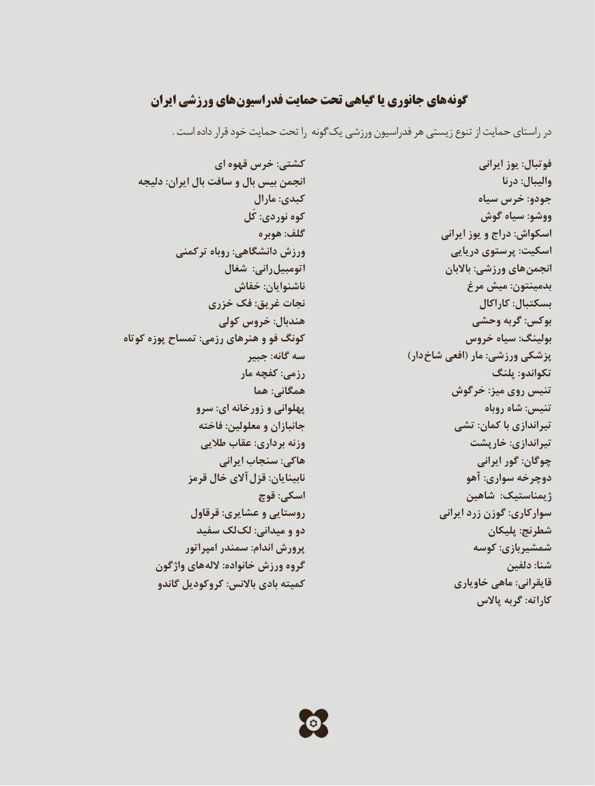

# PDF page 134

ايران ورزشي هاي فدراسيون حمايت تحت گياهي يا جانوري هاي گونه

                      . است داده قرار خود حمايت تحت را گونه يك ورزشي فدراسيون هر زيستي تنوع از حمايت راستاي در
                 ای قهوه خرس :کشتی                                           ایرانی یوز :فوتبال
   دلیجه :ایران بال سافت و بال بیس انجمن                                                  درنا :والیبال
                              مارال :کبدی                                   سیاه خرس :جودو
                            کَل :نوردی کوه                        گوش سیاه :ووشو
                             هوبره :گلف                                 ایرانی یوز و دراج :اسکواش
          ترکمنی روباه :دانشگاهی ورزش                               دریایی پرستوی :اسکیت
                  شغال  :رانی  اتومبیل                                      باالبان :ورزشی های  انجمن
                 خفاش :ناشنوایان                             مرغ میش :بدمینتون
             خزری فک :غریق نجات                                        کاراکال :بسکتبال
                  کولی خروس :هندبال                       وحشی گربه :بوکس
کوتاه پوزه تمساح :رزمی هنرهای و فو کونگ                       خروس سیاه :بولینگ
                        جبیر :گانه سه           ) دار شاخ افعی( مار :ورزشی پزشکی
                            مار کفچه :رزمی                                پلنگ :تکواندو
                           هما  :همگانی                      خرگوش :میز روی تنیس
            سرو :ای زورخانه و پهلوانی                                              روباه شاه :تنیس
               فاخته :معلولین و جانبازان                      تشی :کمان با تیراندازی
               طالیی عقاب :برداری وزنه                           خارپشت :تیراندازی
                        ایرانی سنجاب :هاکی                                          ایرانی گور :چوگان
             قرمز خال آالی  قزل :نابینایان                                آهو :سواری دوچرخه
                        قوچ :اسکی                            شاهین  :ژیمناستیک
              قرقاول :عشایری و روستایی                                 ایرانی زرد گوزن :سوارکاری
             سفید لک لک :میدانی و دو                                      پلیکان :شطرنج
               امپراتور سمندر :اندام پرورش                             کوسه :شمشیربازی
       واژگون های الله :خانواده ورزش گروه                                         دلفین :شنا
        گاندو کروکودیل :باالنس بادی کمیته                              خاویاری ماهی :قایقرانی
                                                                       پاالس گربه :کاراته

                               126126

